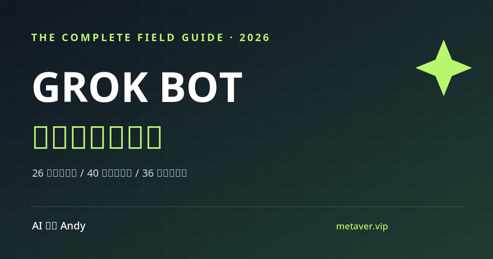

<div align="center">

# Grok Bot 保姆级中文使用攻略

**AI Agent 能替你干活了，接任务和管权限你学会了吗？**

26 章操作教程 · 40 套可复制任务指令 · 36 条 FAQ · 10 类故障诊断 · 7 项上线安全检查 · 7 天上手计划

免费、开源、每条结论可查来源。非官方教程。

[](https://aipmandy.github.io/grok-bot-handbook/)
[](https://github.com/AIPMAndy/grok-bot-handbook/stargazers)
[](LICENSE)
[](https://github.com/AIPMAndy/grok-bot-handbook/actions/workflows/check.yml)
[](https://github.com/AIPMAndy/grok-bot-handbook/actions/workflows/deploy-pages.yml)

[10 分钟入门](guides/START-HERE.md) · [26 章完整版](docs/COMPLETE-GUIDE.md) · [40 套任务指令](docs/PROMPT-LIBRARY.md) · [套餐防坑](docs/BILLING-AND-ACCESS.md) · [7 天计划](guides/7-DAY-PLAN.md) · [English](#english)



</div>

**想找 Grok Bot 中文教程、AI Agent 中文教程？** 这份免费开源的攻略用中文讲清楚 Grok Bot 怎么开通、怎么让它替你干活、怎么管好权限：26 章操作教程、40 套任务指令、36 条 FAQ，每条关键结论都附官方来源。这是非官方教程。

*English: a free, unofficial Chinese tutorial for Grok Bot and AI agents, with 26 chapters, 40 task prompts and 36 FAQs.*

## 这份攻略讲什么

[Grok Bot](https://x.ai/bot) 是 xAI 的 AI Agent 产品：一台持久的云端电脑，加上应用插件、Bot、Skill、Routine、Team Bot 和协同工作。它和 Grok 普通聊天、xAI API、第三方同名脚本都不是一回事。

这份攻略写给想让 Agent 真正替自己干活的中文用户。每章都有目标、步骤、验收和反例；每套任务指令都写了输入、指令、检验标准和需要你批准的边界。

## 先记住三件事

1. **先读、再起草、最后才外发。** 第一次只用公开或已授权的数据，让它分析和起草，不让它替你发出去。
2. **别只看它说"Done"。** 来源、时间、文件内容逐条核对。
3. **自动化之前先做安全检查。** 跑通一次、换输入再跑一次，过完 7 项检查再开长期 Routine。

## 里面有什么

| 栏目 | 数量 | 用途 |
|---|---|---|
| 操作教程 | **26 章** | 登录、资格、云电脑、Bot、Skill、Routine、团队、X @bot、恢复与治理 |
| 任务指令库 | **40 套** | 求职咨询、内容生产、内部运营、开发产品、团队协同与安全 |
| FAQ | **36 条** | 资格、权限、数据、手机、附件、付款与 Routine 故障 |
| 故障诊断 | **10 类** | 选症状，看破坏最小的处理路径和官方出处 |
| 上线安全检查 | **7 项** | 开长期 Routine 前核对授权、数据、风险与回滚 |
| 官方来源 | **19 条** | 产品入口、计费计划、移动端、团队、插件、审批和更新 |
| 上手路线 | **7 天** | 低风险任务 → 复测 Skill → 再考虑 Routine |

## 网站能做什么

- 26 章全文搜索、按类别筛选、标记进度
- 40 套任务指令搜索、筛选、收藏、一键复制
- 36 条 FAQ 搜索，附官方来源链接
- 10 种症状的故障诊断，每种有排查顺序、步骤和官方来源
- 7 项 Routine 上线前检查，逐项勾选
- 7 天行动清单，学习记录可导出 Markdown
- 纯静态网站，无后端，不用注册，不要 API Key

**隐私：** 进度和收藏只存在你自己浏览器的 `localStorage`，不上传。网站不会连接你的邮箱、微信或 Grok Bot 账户。

## 买之前先看：别买错套餐

新版 **The X Subscription Premium / Super / Ultra** 官方包含 Grok Bot，**Plus / Free 不包含**。符合条件的旧版 Cursor 付费、SuperGrok / X Premium+ 关联订阅另有访问流程。新版共享**每周用量池**，旧版用量不能直接套用。

**The X Subscription Premium** 和 **X Premium / X Premium+** 名字相近，不是同一套权益。

付款或开按需计费前，以 [官方实时计划页](https://cursor.com/help/grok-bot/plans) 和 [计费防坑指南](docs/BILLING-AND-ACCESS.md) 为准。

## 完整目录

**上手和操作**

- [10 分钟入门](guides/START-HERE.md) · [26 章教程](docs/COMPLETE-GUIDE.md) · [功能与实测矩阵](docs/CAPABILITY-MATRIX.md) · [7 天行动路线](guides/7-DAY-PLAN.md)
- [套餐、费用与用量](docs/BILLING-AND-ACCESS.md) · [40 套任务指令](docs/PROMPT-LIBRARY.md) · [运营和自动化 SOP](docs/OPERATIONS-PLAYBOOK.md)
- [故障排查](docs/TROUBLESHOOTING.md) · [安全授权](docs/SECURITY.md) · [审批和提示注入防线](docs/APPROVAL-RUNBOOK.md)
- [中文用户注意事项](docs/CHINA-USAGE.md) · [官方来源索引](docs/SOURCES.md)

**模板**

- [Bot 角色模板](templates/BOT-ROLE-TEMPLATE.md) · [Skill 模板](templates/SKILL-TEMPLATE.md) · [Routine 模板](templates/ROUTINE-TEMPLATE.md) · [运行记录空表](templates/TEST-RUN-LOG.csv)

**证据和维护**

- [v2 审计（20 项）](docs/ADVERSARIAL-AUDIT.md) · [v3 发布审计](docs/V3-ADVERSARIAL-AUDIT.md) · [事实溯源台账](docs/FACT-CHECK-LEDGER.md) · [竞品对标](docs/BENCHMARK.md) · [案例证据规范](docs/CASE-STUDY-PROTOCOL.md)
- [发布质量标准](docs/QUALITY-STANDARDS.md) · [待做的人工测试单](docs/QA-MANUAL.md) · [更新日志](docs/CHANGELOG.md)

## 这份攻略怎么保证靠谱

- 12 项高风险结论记在 [`data/claims.json`](data/claims.json)，写明来源、核查日期和复核间隔，过期就不能部署。
- 网站部署必须先通过内容检查（`deploy` 依赖 `verify`）。
- 官方能力标注为"官方资料编辑整理"，任务指令标注为"示例，未声明亲自实测"。
- **目前还没有真实账号的实测成功记录，所以不说"亲测稳定"，也不承诺省多少钱、省多少人。**

当前版本 v3.0.0，资料对照日期 2026-10-21。

## 本地运行和贡献

只需 Python 3.9+ 和 Node.js，不装第三方依赖。

```bash
python3 scripts/check_claims.py
python3 scripts/build_content.py
python3 scripts/export_docs.py
python3 scripts/build_extras.py
python3 -m unittest discover -s tests -v
node --check app.js
node --check data/catalog.js
node --check data/extras.js
python3 -m http.server 8000
# 打开 http://localhost:8000
```

内容唯一来源是 `scripts/build_content.py`，诊断器来源是 `scripts/build_extras.py`。改完要通过检查；代码通过了，真实账号上的功能仍要人工验证。

- 发现错误请提 Issue。涉及套餐权益的，请附官方日期和出处；截图先遮掉敏感信息。
- 不要在公开案例里放客户姓名、私聊、密码、Token、违规采集的数据，也不要编造效果。

## 常见问题 FAQ

### Grok Bot 是什么？

Grok Bot 是 xAI 的 AI Agent 产品：一台持久的云端电脑，加上应用插件、Bot、Skill、Routine、Team Bot 和协同工作。它和 Grok 普通聊天、xAI API、第三方同名脚本都不是一回事。

### 哪些订阅包含 Grok Bot？

按本攻略核验时的官方说明，新版 The X Subscription Premium / Super / Ultra 包含 Grok Bot，Plus / Free 不包含。付款前请看 [官方实时计划页](https://cursor.com/help/grok-bot/plans) 和 [计费防坑指南](docs/BILLING-AND-ACCESS.md)。

### 新手第一天该做什么？

先读、再起草、最后才外发。第一次只用公开或已授权的数据，让它分析和起草，不让它替你发出去。可以照着 [10 分钟入门](guides/START-HERE.md) 和 [7 天计划](guides/7-DAY-PLAN.md) 走。

### 什么时候可以开长期 Routine？

跑通一次，换个输入再跑一次，过完 7 项上线安全检查以后再开。

### 这份 AI Agent 中文教程收费吗？

免费、开源（MIT）。网站是纯静态的，不用注册，也不要 API Key，进度和收藏只存在你自己的浏览器里。

<!-- andy-author-card:start -->
## 作者 / About the author

**AI 酋长 Andy（Andy Liu，GitHub/X @AIPMAndy）**：前腾讯/百度 AI 产品专家，大模型独角兽前 VP，现专注 AI + 产品方法论创业。

可以找我聊求职咨询、AI 增长和副业陪跑，服务范围和费用先沟通确认。咨询是独立、可选的服务，教程不用加微信也能看完，详见 [咨询与陪跑服务](https://metaver.vip/services)。

微信 `AIPMAndy`（备注「Grok Bot 攻略」）· [X @AIPMAndy](https://x.com/AIPMAndy) · [Telegram @AIPMAndy](https://t.me/AIPMAndy) · [个人官网 metaver.vip](https://metaver.vip/) · [Grok Bot 中文攻略](https://aipmandy.github.io/grok-bot-handbook/)

*AI Chief Andy (Andy Liu, @AIPMAndy on GitHub and X) is a former Tencent and Baidu AI product expert and former VP at an LLM unicorn, now a serial entrepreneur focused on AI and product methodology.*

### 作者的其他项目

- [Meta Muse 中文攻略](https://github.com/AIPMAndy/muse-guide)：Meta Muse 个人 AI Agent 中文实战攻略
- [AndySoul](https://github.com/AIPMAndy/AndySoul)：CLAUDE.md / AGENTS.md 规则模板，让 Claude Code、Codex、Cursor 少犯错
- [DNA Memory](https://github.com/AIPMAndy/dna-memory)：Claude Code、Codex 共用的本地 AI Agent 记忆 MCP
- [OpenClaw Skills 中文精选](https://github.com/AIPMAndy/awesome-openclaw-skills-CN)：2868 个 OpenClaw Skills 分类整理，附国产模型接入指南
- [FreeToken](https://github.com/AIPMAndy/FreeToken)：免费 AI API、免费大模型 API 额度合集

<!-- andy-author-card:end -->

## 许可与声明

- 代码采用 MIT License；官方商标、第三方素材和官方文档归各自权利人所有。
- 本项目是独立中文教程，没有官方背书或官方合作。
- 教程只供参考，真实业务请遵守服务条款、当地法规和公司安全规定。

---

## English

**Unofficial Chinese handbook for [Grok Bot](https://x.ai/bot), xAI's AI agent with a persistent cloud computer, plugins, Bots, Skills and Routines.**

26 chapters, 40 copy-ready task prompts, 36 FAQs, 10 troubleshooting paths, a 7-item safety checklist before you automate, and a 7-day starter plan. Free, MIT-licensed, every key claim tracked with its official source and check date. Searchable website: https://aipmandy.github.io/grok-bot-handbook/

Author: Andy ([X @AIPMAndy](https://x.com/AIPMAndy) · [metaver.vip](https://metaver.vip/)). Not affiliated with xAI.
