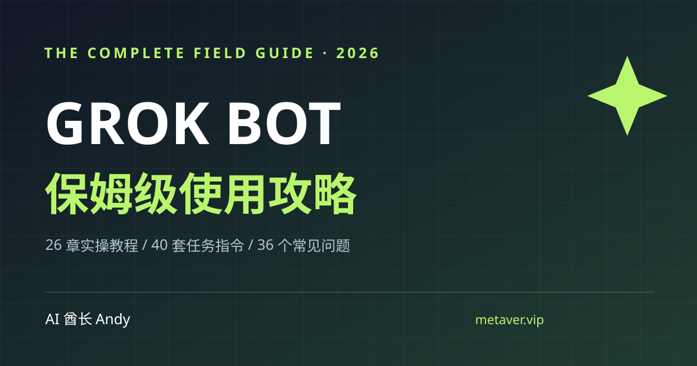

# Grok Bot 保姆级使用攻略 · 中文开源资料库

> **从 0 到可以稳定交付的 AI 员工团队。** 26 章操作教程、40 套可复制任务指令、36 个常见问题、10 类交互式故障诊断、7 项自动化安全检查、7 天上手计划。免费、开源、可复核。

[](https://github.com/AIPMAndy/grok-bot-handbook/actions/workflows/check.yml) [](https://github.com/AIPMAndy/grok-bot-handbook/actions/workflows/deploy-pages.yml)

**作者：AI 酋长 Andy** · [官网](https://metaver.vip/) · [职业 / AI 咨询与陪跑](https://metaver.vip/services) · 微信 `AIPMAndy`（备注「Grok Bot 攻略」）



**在线网站（仓库发布且 Pages 部署后生效）**：https://aipmandy.github.io/grok-bot-handbook/

**先从这里开始：** [10 分钟入门](guides/START-HERE.md) · [26 章完整版](docs/COMPLETE-GUIDE.md) · [40 套可复制指令](docs/PROMPT-LIBRARY.md) · [套餐防坑指南](docs/BILLING-AND-ACCESS.md) · [对抗式审核报告](docs/ADVERSARIAL-AUDIT.md)

## v3.0 质量升级（2026-10-21）

- **先验收再部署：** GitHub Pages workflow 的 `deploy` 必须依赖 `verify`，不得绕过测试直接发布。
- **交互式套餐分流：** 在网页第一步选择新版套餐、旧版 Cursor、SuperGrok 关联或企业组织，链接到对应官方说明。
- **事实溯源台账：** 12 项高风险结论在 [`data/claims.json`](data/claims.json) 记录来源、核查日期、复核间隔和受影响文档；超期将阻止新的部署。
- **社交分享支持：** 新增可兼容更多预览系统的 1200×630 PNG OG 封面，并保留 SVG 原始素材。
- **对抗性验证：** 查看 [v3 红队审计](docs/V3-ADVERSARIAL-AUDIT.md)、[官方事实台账](docs/FACT-CHECK-LEDGER.md)和 [真实账号验收边界](docs/QA-MANUAL.md)。

**v3 仍未包含用户 Grok Bot 账号的实测成功记录，不能对外宣称“亲测稳定”或“全网第一”。**

## 为什么值得收藏

内容的“完整”取决于**能否照着操作、核对来源、发现失败并安全恢复**，不取决于堆几十个没有运行证据的提示词。因此每个章节包含前置目标、具体步骤、验收与反例；每个模板包含输入、任务指令、检验标准与审批边界。

项目涵盖的是 [xAI 官方 Grok Bot](https://x.ai/bot)：持久云端电脑、应用插件、Bot、Skill、Routine、Team Bot 与协同工作。**它不是 Grok 普通聊天、xAI API，也不是第三方同名脚本。** 这是独立中文教程，非官方背书或官方合作。

### 规模与范围

| 栏目 | 本版交付 | 应该怎样用 |
|---|---|---|
| 操作教程 | **26 章** | 登录、资格、云电脑、Bot、Skill、Routine、团队、X @bot、恢复与治理 |
| 提示词工作库 | **40 套** | 求职咨询、内容生产、内部运营、开发产品、团队协同与安全 |
| FAQ | **36 条** | 资格、权限、数据、手机、附件、付款与例程故障 |
| 故障诊断中心 | **10 类** | 选择症状，阅读最小破坏的处理路径与官方出处 |
| 自动化上线审查 | **7 项** | 在开启长期 Routine 前核对授权、数据、风险与回滚 |
| 官方来源 | **19 条** | 产品入口、计费计划、移动端、团队、插件、审批和更新 |
| 实操路线 | **7 天** | 低风险任务 → 复测 Skill → 再考虑 Routine |
| 质量治理 | **持续扩展的结构测试** | 原始内容、链接、数据同步、资料完整性与部署结构 |

**当前版本：v3.0.0，资料对照日期 2026-10-21。** 当前教程默认将官方能力描述标注为“官方资料编辑整理”，将提示词标注为“示例，未声明亲自实测”。本项目尚未提供经过复核的真实生产运行案例，**不宣传保证赚多少钱、省多少人力或必定跑通**。

## 特别重要：不要买错套餐

产品权益已有新旧体系：新版 **The X Subscription Premium / Super / Ultra** 官方包含 Grok Bot，**Plus / Free 不包含**；符合条件的旧版 Cursor 付费及 SuperGrok / X Premium+ 关联订阅另有访问流程。新版的 Grok Bot 使用共享**每周用量池**；旧版用量不可直接套用。购买和开启按需付费前，请以 [官方实时计划矩阵](https://cursor.com/help/grok-bot/plans) 和 [计费防坑指南](docs/BILLING-AND-ACCESS.md) 为准。

不要混淆 **The X Subscription Premium** 与 **X Premium / X Premium+**，名称相近但不是同一权益体系。

## 建议学习顺序

1. **第 0 步：看权限**。先确认自己的账户是否可用，不会产生未知的额外费用。
2. **先做一次安全真实工作**。只使用公开或已授权数据，先读、分析、起草，不外发。
3. **让结果可核对**。逐条核实来源、时间、异常与文件内容，不能只看 Bot 说“Done”。
4. **整理成 Skill**。至少用不同输入重跑一次，确认不依赖某份演示数据。
5. **审计再自动化**。完成 7 项上线审查，测试空数据、重复触发、过期审批与失败恢复。

## 完整资料目录

### 产品与工程

- [操作入门](guides/START-HERE.md) · [26 章教程](docs/COMPLETE-GUIDE.md) · [功能与实测矩阵](docs/CAPABILITY-MATRIX.md)
- [套餐、费用与用量](docs/BILLING-AND-ACCESS.md) · [使用场景和 40 套提示词](docs/PROMPT-LIBRARY.md)
- [运营和自动化 SOP](docs/OPERATIONS-PLAYBOOK.md) · [7 天行动路线](guides/7-DAY-PLAN.md)
- [故障定位与排查](docs/TROUBLESHOOTING.md) · [安全授权](docs/SECURITY.md) · [审批和提示注入防线](docs/APPROVAL-RUNBOOK.md)
- [中文用户注意事项](docs/CHINA-USAGE.md) · [官方来源索引](docs/SOURCES.md)

### 证据和长期维护

- [20 项 v2 审计](docs/ADVERSARIAL-AUDIT.md) · [v3 发布阻断审计](docs/V3-ADVERSARIAL-AUDIT.md) · [事实溯源台账](docs/FACT-CHECK-LEDGER.md) · [竞品对标与差距](docs/BENCHMARK.md) · [案例证据协议](docs/CASE-STUDY-PROTOCOL.md)
- [发布质量门禁](docs/QUALITY-STANDARDS.md) · [待完成的人工测试单](docs/QA-MANUAL.md) · [更新日志](docs/CHANGELOG.md)
- [Bot 角色模板](templates/BOT-ROLE-TEMPLATE.md) · [Skill 模板](templates/SKILL-TEMPLATE.md) · [Routine 模板](templates/ROUTINE-TEMPLATE.md) · [真实运行记录空表](templates/TEST-RUN-LOG.csv)

## 网站实际功能

- 26 章全文关键词搜索、类别筛选、进度标记
- 40 套提示词搜索、筛选、收藏、查看全文与复制
- 36 条 FAQ 搜索与官方来源链接
- **10 种症状故障诊断**，每种有排查优先级、步骤和官方来源
- **7 项 Routine 事前安全检查**，逐项勾选时实时反馈
- 7 天行动清单及当前浏览器的学习记录 Markdown 导出
- 纯 HTML / CSS / JS 静态站，离线打开也可读；无后端、无需注册或 API Key

**本站隐私：** 学习进度和收藏仅保存在当前浏览器 `localStorage`，不发给网站服务器。清理浏览器数据后可能丢失。网站不会自动连接你的邮箱、微信或 Grok Bot 账户。外部官网链接受第三方政策约束。

## 开发、复现与持续更新

只需 Python 3.9+ 和 Node.js（测试 JS 语法），无需安装第三方依赖。

```bash
python3 scripts/check_claims.py
python3 scripts/build_content.py
python3 scripts/export_docs.py
python3 scripts/build_extras.py
python3 -m unittest discover -s tests -v
node --check app.js
node --check data/catalog.js
node --check data/extras.js
python3 -m http.server 8000
# 本地打开 http://localhost:8000
```

**单一内容源**是 `scripts/build_content.py`。修改章节、模板、FAQ、来源后重新生成两份 catalog 和 Markdown。诊断器的源文件是 `scripts/build_extras.py`，它生成 `data/extras.json` 与 `data/extras.js`。改动后必须通过质量门禁；即使代码通过，真实账号功能仍要人工验证。

## 交付 GitHub 和网站

预定仓库：`https://github.com/AIPMAndy/grok-bot-handbook`；预定网站：`https://aipmandy.github.io/grok-bot-handbook/`。**这两个链接只有在仓库创建并发布后才代表已上线。** 不要覆盖已经存在的其它教程项目。

1. 在 GitHub [创建公开仓库](https://github.com/new)，名称填 `grok-bot-handbook`，无需初始化文件。
2. 上传本项目完整文件到 `main` 分支。仓库还不存在时，在本地项目根目录执行：

```bash
git init
git add .
git commit -m "feat: publish Grok Bot Handbook v3"
git branch -M main
git remote add origin https://github.com/AIPMAndy/grok-bot-handbook.git
git push -u origin main
```

3. 打开 [Pages 配置](https://github.com/AIPMAndy/grok-bot-handbook/settings/pages)，将 Build and deployment → Source 设为 **GitHub Actions**。
4. 确认 `Check guide quality` 与 `Deploy website to GitHub Pages` 都成功，随后用无痕窗口实测首页和交互。
5. 最后再在 GitHub About 填网站链接、描述与 Topics。详情见 [LAUNCH.md](LAUNCH.md)。

## 贡献、许可与免责声明

- 开源代码采用 MIT License；官方商标、第三方素材与原始官方文档仍归相应权利人所有。
- 可通过 Issue 提交纠错，涉及产品权益必须提供官方日期与出处；截图须先遮盖敏感信息。
- 严禁在开源案例中暴露客户姓名、私聊、密码、Token、违法采集数据，或编造实现效果。
- 案例、教程只供参考，真实业务应遵循服务条款、所在司法管辖区要求与企业内部安全政策。

### 有具体 AI 工作流项目，可以联系我

**微信：`AIPMAndy`**（添加时备注「Grok Bot 攻略」）｜ **[个人官网](https://metaver.vip/)** ｜ **[咨询与陪跑服务](https://metaver.vip/services)**。

全部免费教程无需添加微信；商业咨询为独立、可选的服务。
